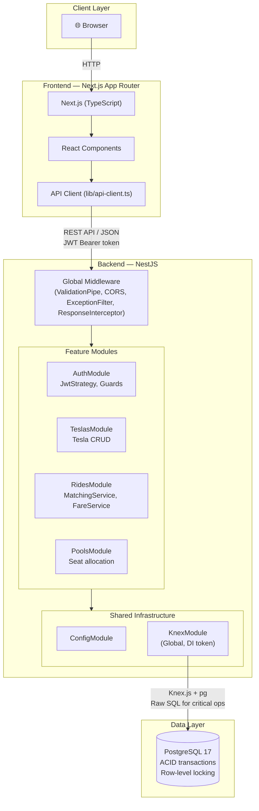
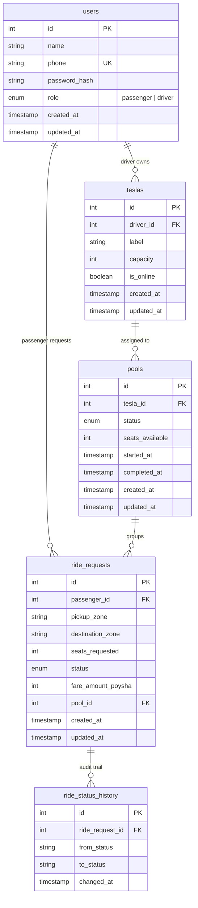

# Dhaka Tesla Pool — Codebase Analysis & Phase 1 Plan

## What Already Exists

### ✅ Solid Foundation (Keep As-Is)

| Component | File | Status |
|---|---|---|
| NestJS scaffolding | [app.module.ts](file:///c:/Users/maeed/OneDrive/Documents/Projects/dhaka-tesla-pool/backend/src/app.module.ts) | ✅ Clean, ConfigModule + KnexModule wired |
| Typed config | [configuration.ts](file:///c:/Users/maeed/OneDrive/Documents/Projects/dhaka-tesla-pool/backend/src/config/configuration.ts) | ✅ All env vars typed with defaults |
| Knex DI module | [knex.module.ts](file:///c:/Users/maeed/OneDrive/Documents/Projects/dhaka-tesla-pool/backend/src/database/knex.module.ts) | ✅ Global module, `KNEX_CONNECTION` token |
| Knex constants | [knex.constants.ts](file:///c:/Users/maeed/OneDrive/Documents/Projects/dhaka-tesla-pool/backend/src/database/knex.constants.ts) | ✅ Symbol-based injection token |
| Health check | [health.controller.ts](file:///c:/Users/maeed/OneDrive/Documents/Projects/dhaka-tesla-pool/backend/src/health.controller.ts) | ✅ DB connectivity verified via `SELECT 1` |
| Knexfile | [knexfile.ts](file:///c:/Users/maeed/OneDrive/Documents/Projects/dhaka-tesla-pool/backend/knexfile.ts) | ✅ Migration/seed dirs configured |
| Docker Compose | [docker-compose.yml](file:///c:/Users/maeed/OneDrive/Documents/Projects/dhaka-tesla-pool/docker-compose.yml) | ✅ Postgres + backend + healthcheck |
| Env files | Both `.env` and `.env.example` at root + backend | ✅ All required vars present |
| Git ignore | Root + backend + frontend `.gitignore` | ✅ Comprehensive |
| TypeScript config | [tsconfig.json](file:///c:/Users/maeed/OneDrive/Documents/Projects/dhaka-tesla-pool/backend/tsconfig.json) | ✅ Strict, ESM, decorators enabled |
| Vitest configs | Both unit and e2e configs | ✅ Properly separated |
| Prettier | [.prettierrc](file:///c:/Users/maeed/OneDrive/Documents/Projects/dhaka-tesla-pool/backend/.prettierrc) | ✅ Single quotes, trailing commas |
| Next.js frontend | App Router scaffolded | ✅ Working but default template |
| Directory skeleton | auth/, teslas/, rides/, pools/, common/ | ✅ All empty dirs created per spec |

### 🔴 Issues Found

| # | Issue | Location | Severity |
|---|---|---|---|
| 1 | **Dockerfile has `.txt` extension** — Docker won't find it, `docker compose up` will fail | [Dockerfile.txt](file:///c:/Users/maeed/OneDrive/Documents/Projects/dhaka-tesla-pool/backend/Dockerfile.txt) | 🔴 Critical |
| 2 | **`main.ts` has double-slash import** — `'.//app.module.js'` works but is sloppy | [main.ts](file:///c:/Users/maeed/OneDrive/Documents/Projects/dhaka-tesla-pool/backend/src/main.ts) L2 | 🟡 Minor |
| 3 | **No global `ValidationPipe`** registered in `main.ts` — DTOs won't validate | [main.ts](file:///c:/Users/maeed/OneDrive/Documents/Projects/dhaka-tesla-pool/backend/src/main.ts) | 🔴 Critical |
| 4 | **No CORS enabled** — frontend can't call backend | [main.ts](file:///c:/Users/maeed/OneDrive/Documents/Projects/dhaka-tesla-pool/backend/src/main.ts) | 🔴 Critical |
| 5 | **Backend README is default NestJS boilerplate** — not project-specific | [README.md](file:///c:/Users/maeed/OneDrive/Documents/Projects/dhaka-tesla-pool/backend/README.md) | 🟡 Will replace in Phase 15 |
| 6 | **E2E test hits `/` expecting "Hello World!"** — no such route exists; will fail | [app.e2e-spec.ts](file:///c:/Users/maeed/OneDrive/Documents/Projects/dhaka-tesla-pool/backend/test/app.e2e-spec.ts) | 🟡 Will fix in Phase 14 |
| 7 | **Frontend is untouched create-next-app default** — metadata says "Create Next App" | [layout.tsx](file:///c:/Users/maeed/OneDrive/Documents/Projects/dhaka-tesla-pool/frontend/app/layout.tsx) L16 | 🟡 Will replace in Phase 11 |
| 8 | **Root README architecture section incomplete** — only has system diagram, no ERD, status says "In Progress" | [README.md](file:///c:/Users/maeed/OneDrive/Documents/Projects/dhaka-tesla-pool/README.md) | 🟡 Will complete |
| 9 | **Missing auth deps** — `@nestjs/passport`, `passport-jwt`, `@nestjs/jwt`, `bcryptjs`, `class-validator`, `class-transformer` not installed | [package.json](file:///c:/Users/maeed/OneDrive/Documents/Projects/dhaka-tesla-pool/backend/package.json) | 🟡 Needed for Phase 5 |
| 10 | **`oxlintrc.json` disables `no-explicit-any`** — contradicts strict TS goal | [.oxlintrc.json](file:///c:/Users/maeed/OneDrive/Documents/Projects/dhaka-tesla-pool/backend/.oxlintrc.json) | 🟡 Will tighten |
| 11 | **Root `package.json` only has `dotenv`** — serves no real purpose | [package.json](file:///c:/Users/maeed/OneDrive/Documents/Projects/dhaka-tesla-pool/package.json) | 🟡 Harmless |

### Architecture Status

```
Phase 1 — Project Initialization & Architecture    → 80% done (scaffolding exists, needs fixes)
Phase 2 — PostgreSQL + Knex + Docker skeleton       → 70% done (compose + knex wired, Dockerfile broken)
Phase 3 — Database Schema & ERD                     → 0% (migrations dir empty)
Phase 4 — Seed Data                                 → 0% (seeds dir empty)
Phase 5 — Authentication                            → 0% (auth dir has empty subdirs only)
Phase 6–16                                          → 0%
```

---

## Phase 1 — Project Initialization & Architecture (Completing)

### Goal

Fix the issues above, add missing configuration to `main.ts`, rename the Dockerfile, add code comments to every existing file, update the architecture diagrams, and confirm both backend and frontend run cleanly.

### What We're Fixing / Adding

1. Rename `Dockerfile.txt` → `Dockerfile`
2. Fix double-slash import in `main.ts`  
3. Add `ValidationPipe`, `CORS`, and comments to `main.ts`
4. Install `class-validator` + `class-transformer` (needed for the pipe now)
5. Add comprehensive comments to every existing source file
6. Update root README with complete architecture diagram + ERD preview
7. Tighten `oxlintrc` to warn on `any` instead of disabling

### Architecture Diagram



### ERD Preview (finalized in Phase 3)


